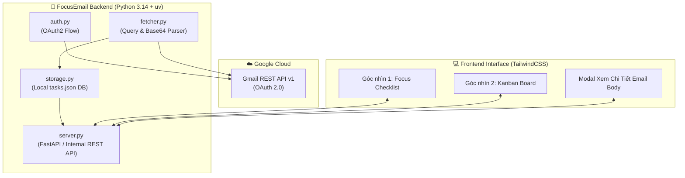

# 🌐 API SPECIFICATION - FOCUSEMAIL ARCHITECTURE

Tài liệu này định nghĩa toàn bộ **Mô hình Dữ liệu và Chuẩn API** cho hệ thống **FocusEmail**.
Dự án được thiết kế theo kiến trúc phân tầng rõ ràng:
1. **External API Layer**: Giao tiếp với Google Gmail REST API.
2. **Core Data Models**: Mô hình hóa dữ liệu nội bộ (Chuẩn hóa từ dữ liệu thô sang đối tượng Task).
3. **Internal API Layer**: REST API nội bộ giữa Python Backend và Giao diện TailwindCSS Frontend.

---

## 🏛️ 1. Sơ Đồ Kiến Trúc API Toàn Dự Án



---

## ☁️ 2. External API: Google Gmail REST API v1

### 2.1. Quyền Truy Cập (OAuth 2.0 Scopes)
* `https://www.googleapis.com/auth/gmail.modify`: Cho phép đọc toàn bộ email, đánh dấu đã đọc/chưa đọc, gán nhãn, lưu trữ.

### 2.2. Các Endpoints Gmail Sử Dụng

#### ① Lấy danh sách ID email (`messages.list`)
* **Endpoint**: `GET https://gmail.googleapis.com/gmail/v1/users/me/messages`
* **Query Parameters**:
  * `q`: `newer_than:7d` (Bộ lọc 7 ngày gần nhất).
  * `maxResults`: `20` (Số lượng mail lấy mỗi trang để tối ưu hiệu năng).
* **Response Output**:
  ```json
  {
    "messages": [
      { "id": "18e6a1b2c3d4e5f6", "threadId": "18e6a1b2c3d4e5f6" }
    ],
    "resultSizeEstimate": 15
  }
  ```

#### ② Lấy chi tiết toàn bộ email (`messages.get`)
* **Endpoint**: `GET https://gmail.googleapis.com/gmail/v1/users/me/messages/{id}`
* **Query Parameters**:
  * `format`: `full`
* **Bóc tách dữ liệu từ Payload**:
  * `payload.headers`: Tìm các header có `name` là:
    * `From`: Tên & Email người gửi.
    * `To`: Email người nhận.
    * `Subject`: Tiêu đề thư.
    * `Date`: Thời gian gửi (RFC 2822).
  * `payload.parts`: Bóc tách nội dung Text/HTML (dữ liệu mã hóa dạng `base64url`).

#### ③ Cập nhật trạng thái email (`messages.modify`) - *Dùng ở Stage 4*
* **Endpoint**: `POST https://gmail.googleapis.com/gmail/v1/users/me/messages/{id}/modify`
* **Request Body**:
  ```json
  {
    "removeLabelIds": ["UNREAD"],
    "addLabelIds": []
  }
  ```

---

## 📦 3. Mô Hình Dữ Liệu Nội Bộ (Core Data Models)

### 3.1. Model: `EmailMessage` (Dữ liệu email đã chuẩn hóa)
```python
from dataclasses import dataclass
from typing import Optional

@dataclass
class EmailMessage:
    id: str                   # ID duy nhất của email trên Gmail (ví dụ: '18e6a1b2c3d4e5f6')
    thread_id: str            # ID chuỗi hội thoại
    sender_name: str          # Tên hiển thị người gửi (ví dụ: 'Google Alerts')
    sender_email: str         # Địa chỉ email người gửi (ví dụ: 'alerts@google.com')
    recipient: str            # Địa chỉ email người nhận
    subject: str              # Tiêu đề email
    date: str                 # Thời gian gửi đã chuẩn hóa
    snippet: str              # Đoạn trích ngắn 1-2 dòng tóm tắt nội dung
    body_text: str            # Toàn bộ nội dung chữ thuần (Plain text)
    body_html: str            # Toàn bộ nội dung định dạng HTML (để render đẹp)
    is_unread: bool           # Email chưa đọc hay đã đọc
    labels: list[str]         # Danh sách nhãn (INBOX, UNREAD, STARRED, v.v.)
```

### 3.2. Model: `EmailTask` (Mô hình công việc hiển thị trên Checklist / Kanban)
```python
from dataclasses import dataclass
from typing import Optional

@dataclass
class EmailTask:
    task_id: str              # Bằng với email.id
    email: EmailMessage       # Toàn bộ thông tin email đính kèm
    status: str               # "TODO" | "IN_PROGRESS" | "DONE"
    priority: str             # "LOW" | "MEDIUM" | "HIGH"
    notes: Optional[str]      # Ghi chú cá nhân thêm vào task
    due_date: Optional[str]   # Hạn chót xử lý
    created_at: str           # Thời điểm tạo task trong FocusEmail
    updated_at: str           # Thời điểm cập nhật trạng thái gần nhất
```

---

## 🔌 4. Internal REST API (Giao Tiếp Giữa Backend & Giao Diện TailwindCSS)

Giao diện TailwindCSS sẽ gọi các API nội bộ này (chạy trên `http://localhost:8000`) để tương tác:

### 1. `GET /api/status`
* **Mục đích**: Kiểm tra trạng thái đăng nhập tài khoản Google.
* **Response**:
  ```json
  {
    "authenticated": true,
    "user_email": "your_email@gmail.com"
  }
  ```

### 2. `GET /api/tasks`
* **Mục đích**: Lấy danh sách task theo bộ lọc.
* **Query Params**:
  * `status`: Lọc theo `TODO`, `IN_PROGRESS`, `DONE`, hoặc bỏ trống để lấy tất cả.
* **Response**:
  ```json
  {
    "total": 12,
    "tasks": [
      {
        "task_id": "18e6a1b2c3d4e5f6",
        "status": "TODO",
        "priority": "HIGH",
        "email": {
          "id": "18e6a1b2c3d4e5f6",
          "sender_name": "Nguyễn Văn A",
          "sender_email": "a@example.com",
          "subject": "Yêu cầu báo giá dự án",
          "date": "2026-09-24 10:30",
          "snippet": "Chào bạn, vui lòng gửi báo giá trước thứ Sáu..."
        }
      }
    ]
  }
  ```

### 3. `GET /api/tasks/{task_id}`
* **Mục đích**: Lấy chi tiết toàn bộ nội dung email (Body Text + HTML) khi người dùng bấm vào xem email trong giao diện.
* **Response**: Toàn bộ thông tin của `EmailTask` bao gồm `body_text` và `body_html`.

### 4. `PATCH /api/tasks/{task_id}`
* **Mục đích**: Cập nhật trạng thái task (khi tích checkbox Hoàn Thành, hoặc kéo sang cột Kanban khác).
* **Request Body**:
  ```json
  {
    "status": "DONE",
    "notes": "Đã gửi phản hồi qua email",
    "priority": "MEDIUM"
  }
  ```
* **Response**:
  ```json
  {
    "success": true,
    "task_id": "18e6a1b2c3d4e5f6",
    "status": "DONE"
  }
  ```

### 5. `POST /api/sync`
* **Mục đích**: Bấm nút "Làm mới / Đồng bộ" trên giao diện:
  1. Kéo email 7 ngày gần nhất từ Gmail về.
  2. Đồng bộ các task đã `DONE` lên Gmail (đánh dấu đã đọc).
* **Response**:
  ```json
  {
    "new_emails_fetched": 3,
    "synced_to_gmail": 2
  }
  ```
