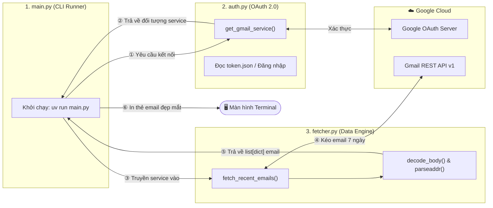
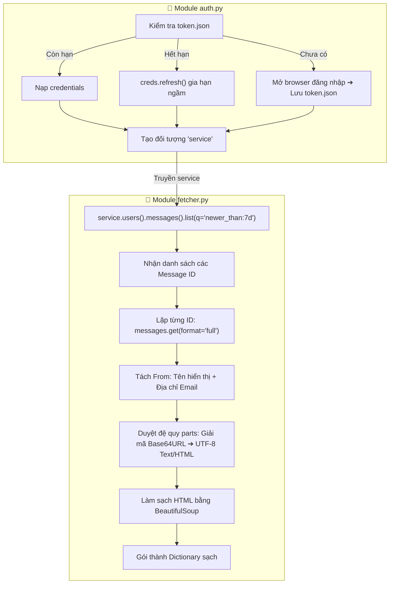

# 📌 ĐỀ BÀI DỰ ÁN - STAGE 1: NỀN TẢNG API, XÁC THỰC OAUTH2 & BÓC TÁCH EMAIL 7 NGÀY (CLI)

---

## 🎯 1. Mục Đích Sau Khi Xong Stage 1 (Definition of Done)

Trước khi bắt tay vào code, bạn cần hiểu rõ **sản phẩm cuối cùng** và **giá trị kiến thức** bạn sẽ đạt được sau khi vượt qua Stage 1:

### 🏆 Sản phẩm thực tế bạn sở hữu:
1. **Một công cụ CLI hoàn chỉnh**: Chạy lệnh `uv run main.py`, hệ thống tự kết nối hòm thư Gmail của bạn, quét toàn bộ email trong vòng 7 ngày gần nhất và hiển thị dạng thẻ gọn gàng trên Terminal.
2. **Cơ chế xác thực 1 chạm**: Lần đầu mở trình duyệt cấp quyền, các lần sau tự động nạp `token.json` hoặc tự làm mới (refresh) trong im lặng mà không bao giờ làm phiền bạn phải đăng nhập lại.
3. **Bộ dữ liệu chuẩn hóa**: Toàn bộ email thô phức tạp được bóc tách sạch sẽ thành Dictionary với đầy đủ các trường: `sender_name`, `sender_email`, `recipient`, `subject`, `date`, `snippet`, `body_text`, `body_html`.
4. **Nền tảng vững chắc cho Web App (Stage 2 & 3)**: Toàn bộ code xử lý logic và kết nối Gmail này sẽ được tái sử dụng trực tiếp làm "động cơ" bên dưới cho giao diện Web (FastAPI + TailwindCSS).

### 🧠 Năng lực lập trình tích lũy:
* Làm chủ quy trình cấp quyền OAuth 2.0 chuẩn quốc tế (Credentials vs Tokens, Refresh Token flow).
* Làm việc với Google Cloud REST API thực tế (Request, Query Filter, Pagination, Error Handling).
* Hiểu sâu cấu trúc dữ liệu MIME lồng ghép của Email (Multipart Email Architecture, Tree Traversal).
* Kỹ năng xử lý dữ liệu nhị phân / mã hóa Base64URL sang chuỗi ký tự UTF-8.

---

## 📊 2. Sơ Đồ Quy Trình & Kiến Trúc Hoạt Động

> 🎨 **Sơ đồ trực quan Excalidraw**: Bạn có thể mở trực tiếp file [stage1.excalidraw](file:///home/billtran/Desktop/EmailTool/docs/stage1.excalidraw) bằng extension Excalidraw trong VS Code để xem sơ đồ màu sắc dạng bảng vẽ tay!

### 2.1. Sơ Đồ Tổng Quan: Ai Gọi Ai? (Module Architecture)



### 2.2. Sơ Đồ Chi Tiết: Luồng Xử Lý Của Từng Module



---

## 🧩 3. Chi Tiết Đề Bài Từng Thử Thách (Step-by-Step Challenges)

Bạn sẽ lần lượt tự lập trình 3 file chính:
1. `src/focus_email/auth.py`
2. `src/focus_email/fetcher.py`
3. `main.py`

---

### 🟢 THỬ THÁCH 1.1: Xây Dựng Module Xác Thực OAuth 2.0
* **File mục tiêu**: `src/focus_email/auth.py`
* **Nhiệm vụ của bạn**: Viết hàm `get_gmail_service(credentials_path="credentials.json", token_path="token.json")` trả về đối tượng Service của Gmail API.

#### 📝 Đặc tả yêu cầu kỹ thuật:
1. **Phạm vi quyền (Scope)**:
   * Ứng dụng cần quyền đọc và gán nhãn email: `"https://www.googleapis.com/auth/gmail.modify"`.
2. **Xử lý 3 trạng thái của Token**:
   * **Trạng thái 1 (Đã có token)**: Kiểm tra nếu file `token.json` đã tồn tại thì dùng `Credentials.from_authorized_user_file()` để nạp vào biến `creds`.
   * **Trạng thái 2 (Token hết hạn)**: Nếu `creds` không còn hợp lệ (`not creds.valid`) nhưng đã hết hạn và có refresh token (`creds.expired and creds.refresh_token`), hãy gọi `creds.refresh(Request())` để tự động gia hạn.
   * **Trạng thái 3 (Lần đầu đăng nhập)**: Nếu hoàn toàn chưa có token:
     * Kiểm tra xem file `credentials.json` có tồn tại không. Nếu không, ném ra ngoại lệ `FileNotFoundError`.
     * Sử dụng `InstalledAppFlow.from_client_secrets_file(credentials_path, SCOPES)` và kích hoạt server cục bộ `flow.run_local_server(port=0)` để trình duyệt tự động mở và nhận mã cấp quyền.
     * Lưu lại credentials vừa nhận được vào `token.json` bằng `creds.to_json()`.
3. **Giá trị trả về**:
   * Gọi `build("gmail", "v1", credentials=creds)` để tạo và trả về đối tượng Gmail Service.

#### 💡 Thư viện gợi ý:
```python
import os.path
from google.auth.transport.requests import Request
from google.oauth2.credentials import Credentials
from google_auth_oauthlib.flow import InstalledAppFlow
from googleapiclient.discovery import build
```

#### 🧪 Tiêu chí nghiệm thu Thử thách 1.1 (Test Gate 1.1):
Thêm khối `if __name__ == "__main__":` ở cuối file `auth.py` để test:
```bash
uv run python src/focus_email/auth.py
```
* **Kỳ vọng**:
  * Trình duyệt tự mở lên yêu cầu đăng nhập và cho phép quyền.
  * File `token.json` xuất hiện trong thư mục dự án.
  * Chạy lại lệnh lần 2: Không còn bật trình duyệt nữa (chạy xuyên suốt chỉ mất 1-2 giây).

---

### 🟡 THỬ THÁCH 1.2: Xây Dựng Module Bóc Tách & Kéo Email
* **File mục tiêu**: `src/focus_email/fetcher.py`
* **Nhiệm vụ của bạn**: Viết các hàm phân tích cấu trúc dữ liệu JSON phức tạp của Gmail API để chuyển thành dạng từ điển (Dictionary) dễ đọc.

#### 📝 Đặc tả yêu cầu kỹ thuật:

#### 1. Hàm `decode_body(payload: dict) -> tuple[str, str]`
* **Đặc tính dữ liệu**: Email trong Gmail API có thể là một thư đơn giản (Single-part) hoặc gồm nhiều phần lồng nhau (Multipart: text, html, attachment). Gmail mã hóa phần nội dung (`body.data`) bằng thuật toán **URL-safe Base64**.
* **Yêu cầu**:
  * Viết một hàm con đệ quy (hoặc vòng lặp) duyệt qua `payload` và các `payload["parts"]` con.
  * Nếu phần nào có `body.data`:
    * Dùng `base64.urlsafe_b64decode` giải mã sang chuỗi UTF-8.
    * Nếu `mimeType == "text/plain"`: gom vào biến `body_text`.
    * Nếu `mimeType == "text/html"`: gom vào biến `body_html`.
  * Nếu không có `text/plain` mà chỉ có `text/html`: Sử dụng `BeautifulSoup(body_html, "html.parser").get_text()` để trích xuất text thuần sạch sẽ.
  * Trả về tuple: `(body_text.strip(), body_html.strip())`.

#### 2. Hàm `parse_email_message(msg_detail: dict) -> dict`
* **Yêu cầu**:
  * Trích xuất các header từ `msg_detail["payload"]["headers"]` (chuyển tên header về chữ thường để dễ tra cứu: `from`, `to`, `subject`, `date`).
  * Sử dụng thư viện chuẩn của Python `from email.utils import parseaddr` trên header `From` để bóc tách riêng:
    * `sender_name`: Tên người gửi (Ví dụ: "Google Security Team").
    * `sender_email`: Địa chỉ email (Ví dụ: "no-reply@accounts.google.com").
  * Gọi hàm `decode_body()` vừa viết ở trên để lấy nội dung.
  * Chuẩn hóa và trả về Dictionary với các key chính xác:
    * `id`: ID của message.
    * `thread_id`: ID của luồng hội thoại.
    * `sender_name`: Tên người gửi.
    * `sender_email`: Email người gửi.
    * `recipient`: Người nhận.
    * `subject`: Tiêu đề thư.
    * `date`: Thời gian gửi thư.
    * `snippet`: Đoạn trích dẫn ngắn từ Gmail.
    * `body_text`: Nội dung chữ thuần.
    * `body_html`: Nội dung định dạng HTML.
    * `labels`: Danh sách nhãn (ví dụ: `UNREAD`, `INBOX`...).

#### 3. Hàm `fetch_recent_emails(service, max_results: int = 10) -> list[dict]`
* **Yêu cầu**:
  * Bước 1: Gọi `service.users().messages().list(userId="me", q="newer_than:7d", maxResults=max_results).execute()`.
  * Bước 2: Lấy danh sách các message item (chú ý: API này chỉ trả về `id` và `threadId`).
  * Bước 3: Lặp qua từng ID, gọi `service.users().messages().get(userId="me", id=msg["id"], format="full").execute()` để lấy JSON chi tiết.
  * Bước 4: Chuyền JSON chi tiết qua hàm `parse_email_message()` để nhận dữ liệu đã làm sạch.
  * Bước 5: Trả về danh sách (`list[dict]`).

#### 💡 Thư viện gợi ý:
```python
import base64
from email.utils import parseaddr
from bs4 import BeautifulSoup
```

#### 🧪 Tiêu chí nghiệm thu Thử thách 1.2 (Test Gate 1.2):
Thêm khối `if __name__ == "__main__":` trong `fetcher.py`, gọi `get_gmail_service()` từ `auth.py`, sau đó gọi `fetch_recent_emails(service, max_results=2)` và in thử:
```bash
uv run python src/focus_email/fetcher.py
```
* **Kỳ vọng**: In ra được 1-2 email với tiêu đề thật, tên người gửi thật và đoạn nội dung đọc được bằng tiếng Việt/tiếng Anh (không bị dính ký tự mã hóa b64 rác).

---

### 🔴 THỬ THÁCH 1.3: Xây Dựng CLI Runner Hoàn Chỉnh
* **File mục tiêu**: `main.py` (đặt tại thư mục gốc của dự án)
* **Nhiệm vụ của bạn**: Kết nối toàn bộ các module lại thành một ứng dụng Terminal có giao diện đẹp mắt.

#### 📝 Đặc tả yêu cầu kỹ thuật:
1. Đón nhận hàm `get_gmail_service()` từ `src.focus_email.auth`.
2. Đón nhận hàm `fetch_recent_emails()` từ `src.focus_email.fetcher`.
3. In tiêu đề chào mừng dự án "FOCUS EMAIL - STAGE 1 CLI".
4. Gọi kéo các email trong 7 ngày gần nhất (mặc định 5 hoặc 10 email).
5. Duyệt qua từng email và in ra định dạng "thẻ email" dễ đọc với các đường phân cách rõ ràng, ví dụ:
   ```text
   ================================================================================
   📩 TIÊU ĐỀ: [Thông báo cuộc họp tuần]
   👤 TỪ: Nguyễn Văn A <nguyenvana@gmail.com>
   📅 NGÀY: Mon, 23 Sep 2026 09:30:00 +0700
   🏷️ NHÃN: UNREAD, INBOX
   --------------------------------------------------------------------------------
   💬 TRÍCH DẪN: Chào mọi người, tuần này chúng ta sẽ họp lúc 10h...
   📝 NỘI DUNG CHÍNH (5 DÒNG ĐẦU):
      ...
   ================================================================================
   ```

#### 🧪 Tiêu chí nghiệm thu Toàn diện Stage 1 (Final Test Gate):
Chạy lệnh khởi chạy dự án:
```bash
uv run main.py
```
* Chương trình chạy mượt mà từ đầu đến cuối không văng Exception.
* Terminal hiển thị các email gần nhất rõ ràng, tách bạch từng thông tin.

---

## 🏁 4. Mục Đích Chuyển Tiếp Sang Stage 2

Sau khi bạn hoàn thành Stage 1 và có danh sách các Dictionary email này trong tay:
* **Stage 2** chúng ta sẽ biến các email này thành đối tượng `EmailTask` (Pydantic / Dataclass), phân loại trạng thái `TODO` / `IN_PROGRESS` / `DONE`, và lưu xuống file CSDL cục bộ `tasks.json`.
* **Stage 3** chúng ta sẽ đưa file `tasks.json` và service này lên giao diện Web TailwindCSS để bạn có thể bấm chuột tích chọn hoàn thành trực tiếp trên trình duyệt!

---

## 📝 5. Nhật Ký Đúc Kết Kinh Nghiệm (Sau khi hoàn thành)

Sau khi code xong và test chạy thành công, bạn hãy điền vào bảng này để tự đánh giá:

```markdown
- Ngày hoàn thành: ...
- Điều thú vị nhất học được về OAuth 2.0: ...
- Thách thức lớn nhất khi giải mã MIME Body & cách giải quyết: ...
- Mức độ tự tin về luồng dữ liệu (1-10): .../10
```
