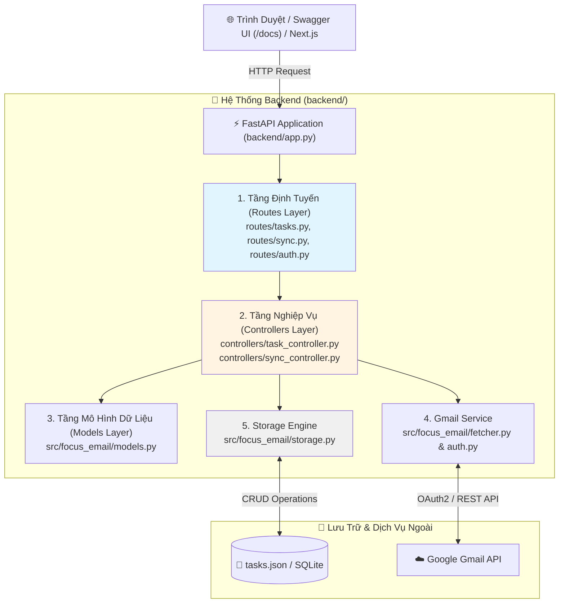
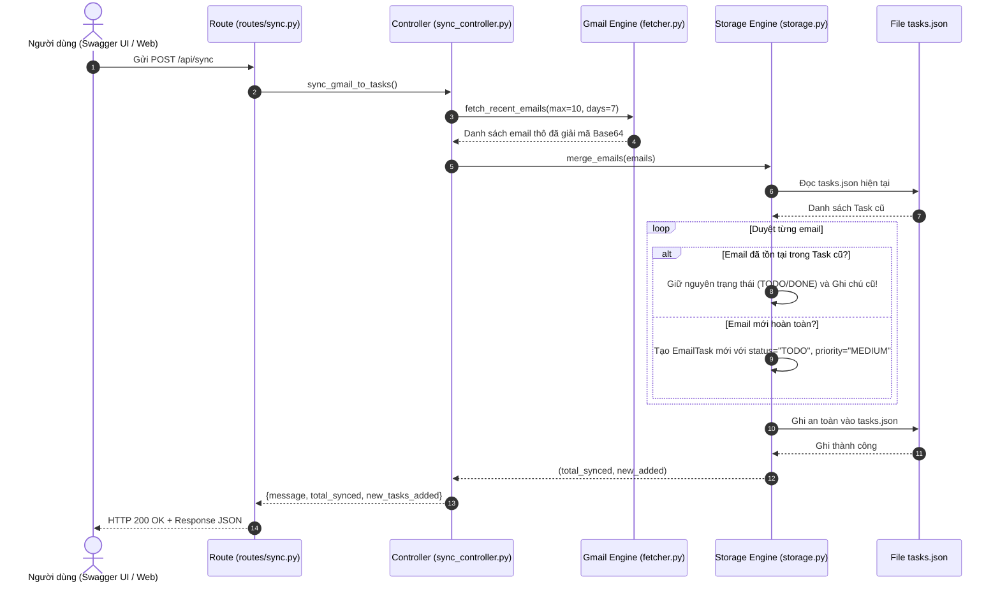
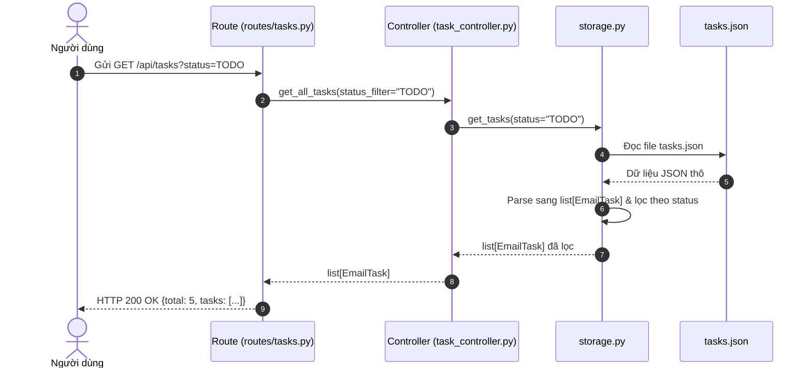
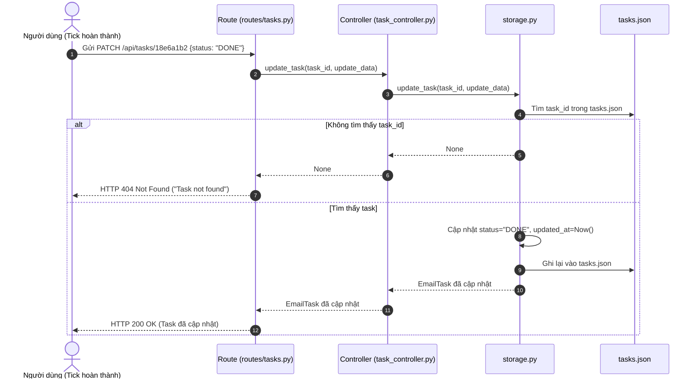

# 📌 ĐỀ BÀI DỰ ÁN - STAGE 2: XÂY DỰNG BACKEND FASTAPI, MÔ HÌNH HÓA TASK & RESTFUL API

---

## 🎯 1. Mục Đích Sau Khi Xong Stage 2 (Definition of Done)

Sau khi hoàn thành Stage 1 (kéo email dạng CLI), Stage 2 sẽ đưa bạn từ một lập trình viên viết script đơn giản lên tầm **kỹ sư Backend xây dựng Web API chuẩn mực**:

### 🏆 Sản phẩm thực tế bạn sở hữu:
1. **Một Web API Server hoàn chỉnh với FastAPI**: Chạy trên `http://localhost:8000`, có giao diện **Swagger UI** tương tác trực quan tại `/docs`.
2. **Cơ chế mô hình hóa dữ liệu (Pydantic Models)**: Biến các email thô thành đối tượng `EmailTask` có trạng thái rõ ràng (`TODO`, `IN_PROGRESS`, `DONE`, `ARCHIVED`), độ ưu tiên, ghi chú cá nhân và hạn chót.
3. **Động cơ lưu trữ cục bộ (Local Storage Engine)**: Tự động lưu trữ và đồng bộ dữ liệu vào `tasks.json` (hoặc SQLite), đảm bảo tắt server bật lại vẫn giữ nguyên mọi việc đã đánh dấu hoàn thành.
4. **Cơ chế Sync thông minh (Smart Merge)**: Kéo email mới từ Gmail về nhưng **không ghi đè** lên trạng thái hay ghi chú của những task bạn đã xử lý trước đó.
5. **Nền tảng sẵn sàng cho Next.js (Stage 3)**: Mọi endpoint đều thiết lập CORS và trả về định dạng JSON chuẩn RESTful, giúp giao diện Frontend gọi API mượt mà.

### 🧠 Năng lực lập trình tích lũy:
* Làm chủ framework **FastAPI** và máy chủ bất đồng bộ **Uvicorn (ASGI)**.
* Thành thạo **Pydantic v2**: Xác thực dữ liệu (Validation), tự động chuyển đổi kiểu (Serialization), tạo OpenAPI Schema.
* Tư duy thiết kế **Kiến trúc phần mềm phân tầng (Layered Architecture)**: Tách rời Controller (Endpoints), Service (Business Logic), và Repository/Storage (Data Access).
* Nắm vững các chuẩn thiết kế **RESTful API**: HTTP Methods (`GET`, `POST`, `PATCH`), Status Codes (`200 OK`, `404 Not Found`), Query Parameters và Request Body.

---

## 📊 2. Sơ Đồ Quy Trình & Kiến Trúc Hoạt Động (Flow Diagrams)

### 2.1. Sơ Đồ Tổng Quan: Kiến Trúc Phân Tầng Của Backend (Layered Architecture)



---

### 2.2. Sơ Đồ Luồng Xử Lý 3 Thao Tác Cốt Lõi (Core API Flows)

#### A. Luồng Kéo Email & Đồng Bộ Task (`POST /api/sync`)


#### B. Luồng Lấy Danh Sách Task (`GET /api/tasks?status=...`)


#### C. Luồng Cập Nhật Tiến Độ Task (`PATCH /api/tasks/{task_id}`)


---

## 📁 3. Trách Nhiệm Từng File Trong Thư Mục `backend/` (Kiến Trúc Dự Án Thật)

Dự án tuân thủ kiến trúc phân tách trách nhiệm chuẩn dự án thực tế (Professional Separation of Concerns):

```text
backend/
├── app.py                      # [ENTRY POINT] Khởi tạo FastAPI app, cấu hình CORS, đăng ký routers
├── main.py                     # [CLI TEST RUNNER] Giữ lại từ Stage 1 để test nhanh trên terminal
├── credentials.json            # [BẢO MẬT] Thông tin ứng dụng Google Cloud
├── token.json                  # [BẢO MẬT] Token đăng nhập của tài khoản người dùng
├── tasks.json                  # [CƠ SỞ DỮ LIỆU] File JSON lưu trữ danh sách tasks (tự sinh)
│
├── routes/                     # [TẦNG ĐỊNH TUYẾN] Định nghĩa các REST endpoints
│   ├── __init__.py
│   ├── tasks.py                # Route handlers cho /api/tasks
│   ├── sync.py                 # Route handler cho /api/sync
│   └── auth.py                 # Route handler cho /api/status
│
├── controllers/                # [TẦNG NGHIỆP VỤ] Business logic xử lý request
│   ├── __init__.py
│   ├── task_controller.py      # Logic xử lý CRUD tasks
│   └── sync_controller.py      # Logic đồng bộ Gmail → Tasks
│
└── src/focus_email/            # [TẦNG DỮ LIỆU & MODELS]
    ├── __init__.py             # Export các class & hàm cốt lõi ra ngoài package
    ├── auth.py                 # [TẦNG BẢO MẬT] Xử lý xác thực OAuth2 & tự động làm mới token
    ├── fetcher.py              # [TẦNG DỮ LIỆU GMAIL] Kéo email, bóc tách cây MIME, giải mã Base64URL
    ├── models.py               # [TẦNG SCHEMA] Định nghĩa cấu trúc Pydantic Models & Enums
    └── storage.py              # [TẦNG LƯU TRỮ LOCAL] Đọc/ghi tasks.json, quản lý thêm/sửa/lọc task
```

### 📊 So Sánh Luồng Xử Lý: Trước và Sau

#### **Trước (Không tách):**
```
HTTP Request → app.py (Route + Controller + Logic) → storage.py → Response
```

#### **Sau (Có tách - Chuẩn dự án thật):**
```
HTTP Request → routes/ (Nhận request) 
            → controllers/ (Xử lý nghiệp vụ) 
            → storage.py (Đọc/ghi dữ liệu) 
            → controllers/ (Xử lý kết quả)
            → routes/ (Trả response)
```

### 📋 Chi Tiết Trách Nhiệm Từng Tầng

| Tầng | File | Trách nhiệm chính | Ví dụ code |
| :--- | :--- | :--- | :--- |
| **Entry Point** | `app.py` | Khởi tạo FastAPI app, đăng ký routers, cấu hình CORS | `app.include_router(tasks_router)` |
| **Routes** | `routes/tasks.py` | Nhận HTTP request, parse parameters, gọi controller, trả response | `@router.get("/api/tasks")` |
| **Controllers** | `controllers/task_controller.py` | Business logic: validation, xử lý dữ liệu, gọi storage | `def get_all_tasks(status=None):` |
| **Models** | `src/focus_email/models.py` | Định nghĩa cấu trúc dữ liệu Pydantic | `class EmailTask(BaseModel):` |
| **Storage** | `src/focus_email/storage.py` | CRUD operations với file/database | `def load_all() -> list[EmailTask]:` |

### 🎯 Lợi Ích Của Kiến Trúc Này

1. **Tách biệt trách nhiệm rõ ràng**:
   - Routes chỉ lo HTTP (status codes, headers, query params)
   - Controllers chỉ lo nghiệp vụ (validation, transform data)
   - Storage chỉ lo lưu trữ (file I/O, database queries)

2. **Dễ test**:
   - Test controller mà không cần HTTP server
   - Test storage mà không cần controller
   - Mock dễ dàng giữa các tầng

3. **Dễ bảo trì và mở rộng**:
   - Thêm endpoint mới: chỉ tạo file trong `routes/`
   - Thay đổi nghiệp vụ: chỉ sửa `controllers/`
   - Đổi database: chỉ sửa `storage.py`

4. **Chuẩn dự án thật**:
   - Nhiều người làm chung không conflict code
   - Code review dễ dàng (review từng tầng riêng)
   - Onboarding developer mới nhanh hơn

---

## 🌐 4. Thiết Kế Chuẩn RESTful API

Hệ thống cung cấp 5 REST Endpoints chuẩn mực:

### 1. `GET /`
* **Mục đích**: Health check kiểm tra server có đang sống không.
* **HTTP Status**: `200 OK`
* **Response**:
  ```json
  {
    "status": "online",
    "service": "FocusEmail Backend",
    "docs_url": "/docs"
  }
  ```

### 2. `GET /api/status`
* **Mục đích**: Kiểm tra ứng dụng đã đăng nhập tài khoản Gmail chưa.
* **HTTP Status**: `200 OK`
* **Response**:
  ```json
  {
    "authenticated": true,
    "user_email": "t20067771@gmail.com"
  }
  ```

### 3. `GET /api/tasks`
* **Mục đích**: Lấy danh sách các task để hiển thị lên giao diện Focus Checklist hoặc Kanban.
* **Query Parameters**:
  * `status` *(tùy chọn)*: Lọc theo `"TODO"`, `"IN_PROGRESS"`, `"DONE"`, `"ARCHIVED"`. Nếu không truyền thì lấy tất cả.
* **HTTP Status**: `200 OK`
* **Response**:
  ```json
  {
    "total": 2,
    "tasks": [
      {
        "task_id": "18e6a1b2c3d4e5f6",
        "status": "TODO",
        "priority": "HIGH",
        "notes": "Cần phản hồi trước 5h chiều",
        "due_date": "2026-09-30",
        "created_at": "2026-09-27T14:00:00Z",
        "updated_at": "2026-09-27T14:00:00Z",
        "email": {
          "id": "18e6a1b2c3d4e5f6",
          "thread_id": "18e6a1b2c3d4e5f6",
          "sender_name": "Google Security",
          "sender_email": "no-reply@accounts.google.com",
          "recipient": "t20067771@gmail.com",
          "subject": "Cảnh báo bảo mật mới",
          "date": "Sun, 27 Sep 2026 12:00:00 +0000",
          "snippet": "Một thiết bị lạ vừa đăng nhập...",
          "body_text": "Chi tiết cảnh báo đăng nhập...",
          "body_html": "<p>Chi tiết...</p>",
          "is_unread": true,
          "labels": ["INBOX", "UNREAD"]
        }
      }
    ]
  }
  ```

### 4. `PATCH /api/tasks/{task_id}`
* **Mục đích**: Cập nhật trạng thái (tick hoàn thành), đổi độ ưu tiên hoặc thêm ghi chú cho 1 task cụ thể.
* **Path Parameter**: `task_id` (chuỗi ID của task).
* **Request Body** (`TaskUpdate`):
  ```json
  {
    "status": "DONE",
    "notes": "Đã gửi phản hồi xong"
  }
  ```
* **HTTP Status**:
  * `200 OK`: Cập nhật thành công, trả về toàn bộ thông tin `EmailTask` mới nhất.
  * `404 Not Found`: Không tìm thấy task có ID tương ứng.

### 5. `POST /api/sync`
* **Mục đích**: Bấm nút "Làm mới / Đồng bộ" trên giao diện để kết nối Gmail API, kéo email 7 ngày gần nhất về và merge vào danh sách task.
* **HTTP Status**: `200 OK`
* **Response**:
  ```json
  {
    "message": "Đồng bộ thành công!",
    "total_synced": 5,
    "new_tasks_added": 2
  }
  ```

---

## 🧩 5. Chi Tiết Các Thử Thách Cần Thực Hiện (Step-by-Step)

Bạn sẽ lần lượt hoàn thiện 5 bước lớn:

---

### 🟢 BƯỚC 0: Tạo Cấu Trúc Thư Mục
* **Mục tiêu**: Tạo các thư mục `routes/` và `controllers/` theo kiến trúc chuẩn dự án thật

```bash
# Di chuyển vào thư mục backend
cd backend

# Tạo thư mục routes và controllers
mkdir -p routes controllers

# Tạo file __init__.py
touch routes/__init__.py controllers/__init__.py

# Tạo các file route
touch routes/auth.py routes/tasks.py routes/sync.py

# Tạo các file controller
touch controllers/task_controller.py controllers/sync_controller.py
```

Sau bước này, cấu trúc thư mục sẽ như sau:
```
backend/
├── routes/
│   ├── __init__.py
│   ├── auth.py
│   ├── tasks.py
│   └── sync.py
├── controllers/
│   ├── __init__.py
│   ├── task_controller.py
│   └── sync_controller.py
└── ... (các file khác)
```

---

### 🟢 THỬ THÁCH 2.1: Hoàn Thiện Pydantic Models (`models.py`)
* **File mục tiêu**: [`backend/src/focus_email/models.py`](file:///home/billtran/Desktop/EmailTool/backend/src/focus_email/models.py) *(Đã có bản mẫu chuẩn)*.
* **Nhiệm vụ**:
  1. Hiểu bản chất các Enum: `TaskStatus` (`TODO`, `IN_PROGRESS`, `DONE`, `ARCHIVED`) và `TaskPriority` (`LOW`, `MEDIUM`, `HIGH`).
  2. Nắm rõ cách lồng ghép Model: Model `EmailTask` chứa bên trong một đối tượng `EmailMessage`.
  3. Sử dụng `Field(default=..., description=...)` để tài liệu Swagger UI tự động hiển thị mô tả tiếng Việt dễ hiểu.

---

### 🟢 THỬ THÁCH 2.2: Xây Dựng Engine Lưu Trữ Cục Bộ (`storage.py`)
* **File mục tiêu**: [`backend/src/focus_email/storage.py`](file:///home/billtran/Desktop/EmailTool/backend/src/focus_email/)
* **Nhiệm vụ**: Viết class `TaskStorage` quản lý việc lưu trữ vào file [`backend/tasks.json`](file:///home/billtran/Desktop/EmailTool/backend/):
  1. **Hàm `load_all() -> list[EmailTask]`**:
     * Đọc file `tasks.json`. Nếu file chưa tồn tại thì trả về danh sách rỗng `[]`.
     * Chuyển đổi từng phần tử JSON dạng dict thành đối tượng `EmailTask.model_validate(item)`.
  2. **Hàm `save_all(tasks: list[EmailTask])`**:
     * Chuyển danh sách `EmailTask` thành JSON (`[t.model_dump() for t in tasks]`).
     * Ghi đè vào file `tasks.json` với `indent=2` và `ensure_ascii=False` để hỗ trợ tiếng Việt có dấu.
  3. **Hàm `get_tasks(status: Optional[TaskStatus] = None) -> list[EmailTask]`**:
     * Lấy toàn bộ danh sách task, nếu có truyền `status` thì lọc theo `status`.
  4. **Hàm `get_task_by_id(task_id: str) -> Optional[EmailTask]`**:
     * Tìm kiếm và trả về task có `task_id` tương ứng.
  5. **Hàm `update_task(task_id: str, update_data: TaskUpdate) -> Optional[EmailTask]`**:
     * Tìm task trong danh sách. Nếu thấy, chỉ cập nhật các trường có giá trị khác `None`.
     * Tự động cập nhật `updated_at = datetime.now(timezone.utc).isoformat()`.
     * Gọi `save_all()` để lưu lại.
  6. **Hàm `merge_emails(emails: list[dict]) -> tuple[int, int]`**:
     * Nhận danh sách email thô từ Gmail API.
     * Kiểm tra từng email: nếu đã có trong `tasks.json` thì giữ nguyên trạng thái cũ; nếu chưa có thì tạo mới `EmailTask` với `status="TODO"`.
     * Lưu lại toàn bộ và trả về `(tổng_số_email, số_task_mới_được_thêm)`.

---

### 🟢 THỬ THÁCH 2.3: Xây Dựng Controllers (Business Logic Layer)
* **File mục tiêu**: `backend/controllers/`
* **Nhiệm vụ**: Tạo các controller xử lý nghiệp vụ, tách biệt khỏi HTTP logic

#### **A. File `controllers/task_controller.py`**:
```python
"""
Task Controller - Xử lý nghiệp vụ liên quan đến tasks
"""
from typing import Optional, List
from src.focus_email.models import EmailTask, TaskUpdate, TaskStatus
from src.focus_email.storage import TaskStorage

# Khởi tạo storage engine (singleton pattern)
storage = TaskStorage()

def get_all_tasks(status_filter: Optional[TaskStatus] = None) -> List[EmailTask]:
    """
    Lấy danh sách tasks, có thể lọc theo status
    
    Args:
        status_filter: Trạng thái cần lọc (TODO/IN_PROGRESS/DONE/ARCHIVED)
    
    Returns:
        Danh sách EmailTask
    """
    return storage.get_tasks(status_filter)

def get_task_by_id(task_id: str) -> Optional[EmailTask]:
    """
    Lấy chi tiết 1 task theo ID
    
    Returns:
        EmailTask nếu tìm thấy, None nếu không tìm thấy
    """
    return storage.get_task_by_id(task_id)

def update_task(task_id: str, update_data: TaskUpdate) -> Optional[EmailTask]:
    """
    Cập nhật thông tin task
    
    Returns:
        EmailTask đã cập nhật, hoặc None nếu không tìm thấy
    """
    return storage.update_task(task_id, update_data)
```

#### **B. File `controllers/sync_controller.py`**:
```python
"""
Sync Controller - Xử lý đồng bộ Gmail → Tasks
"""
from src.focus_email.fetcher import fetch_recent_emails
from src.focus_email.storage import TaskStorage

storage = TaskStorage()

def sync_gmail_to_tasks() -> dict:
    """
    Kéo email từ Gmail và merge vào tasks.json
    
    Returns:
        Dict chứa kết quả sync: {
            "message": str,
            "total_synced": int,
            "new_tasks_added": int
        }
    """
    # Bước 1: Kéo email từ Gmail
    emails = fetch_recent_emails(max_results=10, days_back=7)
    
    # Bước 2: Merge vào storage (smart merge - không ghi đè task cũ)
    total_synced, new_added = storage.merge_emails(emails)
    
    return {
        "message": "Đồng bộ thành công!",
        "total_synced": total_synced,
        "new_tasks_added": new_added
    }
```

---

### 🟢 THỬ THÁCH 2.4: Xây Dựng Routes (HTTP Request Handlers)
* **File mục tiêu**: `backend/routes/`
* **Nhiệm vụ**: Tạo các route handlers, chỉ lo HTTP logic, gọi controllers xử lý nghiệp vụ

#### **A. File `routes/__init__.py`**:
```python
"""
Export tất cả routers để app.py dễ import
"""
from .tasks import router as tasks_router
from .sync import router as sync_router
from .auth import router as auth_router

__all__ = ["tasks_router", "sync_router", "auth_router"]
```

#### **B. File `routes/auth.py`**:
```python
"""
Auth Routes - Xử lý authentication status
"""
import os
from fastapi import APIRouter
from src.focus_email.models import AuthStatusResponse
from src.focus_email.auth import _resolve_path

router = APIRouter(tags=["Auth"])

@router.get("/api/status", response_model=AuthStatusResponse)
def get_auth_status():
    """Kiểm tra trạng thái đăng nhập Gmail OAuth2"""
    token_file = _resolve_path("token.json")
    has_token = os.path.exists(token_file)
    return AuthStatusResponse(
        authenticated=has_token,
        user_email="t20067771@gmail.com" if has_token else None,
    )
```

#### **C. File `routes/tasks.py`**:
```python
"""
Task Routes - REST endpoints cho quản lý tasks
"""
from typing import Optional
from fastapi import APIRouter, HTTPException, Query
from src.focus_email.models import EmailTask, TaskUpdate, TaskListResponse, TaskStatus
from controllers import task_controller

router = APIRouter(tags=["Tasks"])

@router.get("/api/tasks", response_model=TaskListResponse)
def get_tasks(status: Optional[TaskStatus] = Query(None, description="Lọc theo trạng thái")):
    """
    Lấy danh sách tasks
    
    - **status** (optional): Lọc theo TODO/IN_PROGRESS/DONE/ARCHIVED
    """
    tasks = task_controller.get_all_tasks(status_filter=status)
    return TaskListResponse(total=len(tasks), tasks=tasks)

@router.get("/api/tasks/{task_id}", response_model=EmailTask)
def get_task_detail(task_id: str):
    """Lấy chi tiết 1 task theo ID"""
    task = task_controller.get_task_by_id(task_id)
    if not task:
        raise HTTPException(status_code=404, detail="Task not found")
    return task

@router.patch("/api/tasks/{task_id}", response_model=EmailTask)
def update_task(task_id: str, update_data: TaskUpdate):
    """
    Cập nhật trạng thái/ghi chú/độ ưu tiên của task
    
    - Chỉ cập nhật các trường được truyền vào (partial update)
    """
    updated_task = task_controller.update_task(task_id, update_data)
    if not updated_task:
        raise HTTPException(status_code=404, detail="Task not found")
    return updated_task
```

#### **D. File `routes/sync.py`**:
```python
"""
Sync Routes - Đồng bộ Gmail
"""
from fastapi import APIRouter
from controllers import sync_controller

router = APIRouter(tags=["Sync"])

@router.post("/api/sync")
def sync_gmail():
    """
    Kéo email từ Gmail và merge vào tasks
    
    - Kéo 10 email mới nhất trong 7 ngày
    - Smart merge: Không ghi đè trạng thái task đã xử lý
    """
    result = sync_controller.sync_gmail_to_tasks()
    return result
```

---

### 🟢 THỬ THÁCH 2.5: Cập Nhật Entry Point `app.py`
* **File mục tiêu**: [`backend/app.py`](file:///home/billtran/Desktop/EmailTool/backend/app.py)
* **Nhiệm vụ**: Đăng ký các routers vào FastAPI app

```python
"""
FastAPI Entry Point cho FocusEmail Backend.
Cung cấp RESTful API cho Frontend Next.js và tự động sinh Swagger Docs tại /docs.
"""
from fastapi import FastAPI
from fastapi.middleware.cors import CORSMiddleware
from routes import tasks_router, sync_router, auth_router

app = FastAPI(
    title="FocusEmail API",
    description="Backend RESTful API cho dự án FocusEmail (FastAPI + Next.js + Ollama)",
    version="0.1.0",
)

# Cấu hình CORS
app.add_middleware(
    CORSMiddleware,
    allow_origins=["http://localhost:3000", "http://127.0.0.1:3000"],
    allow_credentials=True,
    allow_methods=["*"],
    allow_headers=["*"],
)

# Đăng ký routers
app.include_router(auth_router)
app.include_router(tasks_router)
app.include_router(sync_router)

@app.get("/", tags=["General"])
def read_root():
    """Health check endpoint"""
    return {
        "status": "online",
        "service": "FocusEmail Backend",
        "docs_url": "/docs",
    }
```

---

### 🧪 6. Test Gate (Tiêu Chuẩn Nghiệm Thu Stage 2)

Bạn đạt chuẩn hoàn thành Stage 2 khi thực hiện đầy đủ kịch bản kiểm thử sau trên **Swagger UI** (`http://localhost:8000/docs`):

1. **Test 1 - Kiểm tra trạng thái**:
   * Bấm vào `GET /api/status` ➔ Bấm **Try it out** ➔ **Execute**.
   * Kết quả: Trả về HTTP 200 với `authenticated: true`.
2. **Test 2 - Đồng bộ email thành Task**:
   * Bấm vào `POST /api/sync` ➔ Bấm **Execute**.
   * Kết quả: Hệ thống báo đồng bộ thành công ít nhất 1-5 email và file [`backend/tasks.json`](file:///home/billtran/Desktop/EmailTool/backend/) xuất hiện trên đĩa.
3. **Test 3 - Lấy danh sách Task**:
   * Bấm vào `GET /api/tasks` ➔ Bấm **Execute**.
   * Kết quả: Trả về danh sách JSON chứa các task với đầy đủ trường dữ liệu.
4. **Test 4 - Tick hoàn thành 1 Task**:
   * Lấy `task_id` của 1 task từ Test 3.
   * Bấm vào `PATCH /api/tasks/{task_id}` ➔ Nhập body: `{"status": "DONE", "notes": "Đã xử lý xong"}` ➔ **Execute**.
   * Kết quả: Task đó chuyển thành `"status": "DONE"`.
5. **Test 5 - Kiểm tra tính bền vững (Persistence Test)**:
   * Tắt server (`Ctrl + C`) trong terminal ➔ Chạy lại `uvicorn app:app --reload`.
   * Gọi lại `GET /api/tasks`: Task vừa đánh dấu `DONE` vẫn giữ nguyên trạng thái `DONE`, không bị mất!

---

## 📝 7. Báo Cáo Đúc Kết Kiến Thức Sau Stage 2
```markdown
# 📝 BÁO CÁO ĐÚC KẾT KIẾN THỨC - STAGE 2: BACKEND FASTAPI & RESTFUL API

### 1. 🎯 Mục tiêu đã đạt được:
- [x] Đã hiểu cách thức hoạt động của FastAPI và Swagger UI (/docs).
- [x] Đã làm chủ Pydantic Model để xác thực và serialize dữ liệu.
- [x] Đã xây dựng cơ chế lưu trữ cục bộ độc lập với Database phức tạp.
- [x] Đã hiểu tư duy Smart Merge để không bị ghi đè dữ liệu khi kéo email mới.
- [x] Đã áp dụng kiến trúc phân tầng (Routes → Controllers → Storage) chuẩn dự án thật.

### 2. 🧠 Những khái niệm / kỹ thuật mới học được:
- **FastAPI Router**: Tách endpoints theo feature (tasks, sync, auth) bằng APIRouter
- **Layered Architecture**: Tách biệt HTTP logic (routes), Business logic (controllers), Data access (storage)
- **Pydantic BaseModel**: Validation, serialization, auto OpenAPI schema generation
- **HTTP Methods & RESTful**: GET (read), POST (create), PATCH (partial update), Status codes (200/404)
- **Smart Merge Strategy**: Merge email mới mà không ghi đè trạng thái task cũ
- **Separation of Concerns**: Mỗi tầng có trách nhiệm rõ ràng, dễ test và maintain

### 3. 🏗️ Kiến Trúc Code Đã Xây Dựng:
```
Routes (HTTP) → Controllers (Business Logic) → Storage (Data) → JSON File
```
- **Routes**: Parse request, validate, call controller, return response
- **Controllers**: Implement business rules, coordinate between services
- **Storage**: CRUD operations, file I/O, data persistence

### 4. 💡 Điểm Khác Biệt So Với Dự Án Nhỏ:
- ✅ Code có tổ chức rõ ràng, dễ tìm bug
- ✅ Nhiều người làm chung không conflict
- ✅ Dễ test từng tầng độc lập
- ✅ Dễ mở rộng: thêm endpoint mới chỉ tạo file trong routes/
- ✅ Dễ đổi database: chỉ sửa storage.py, không động vào routes/controllers

### 5. ⭐ Điểm tự đánh giá mức độ tự tin (1 - 10): .../10

### 6. 🚀 Bước Tiếp Theo (Stage 3):
- Xây dựng Frontend Next.js để tương tác với API
- Tích hợp Ollama LLM để phân tích và tóm tắt email
- Xây dựng UI Kanban board và Focus Checklist
```

---

## 🎓 8. Tài Liệu Tham Khảo
- [FastAPI Official Documentation](https://fastapi.tiangolo.com/)
- [Pydantic V2 Documentation](https://docs.pydantic.dev/latest/)
- [RESTful API Design Best Practices](https://restfulapi.net/)
- [Python Type Hints (typing module)](https://docs.python.org/3/library/typing.html)
