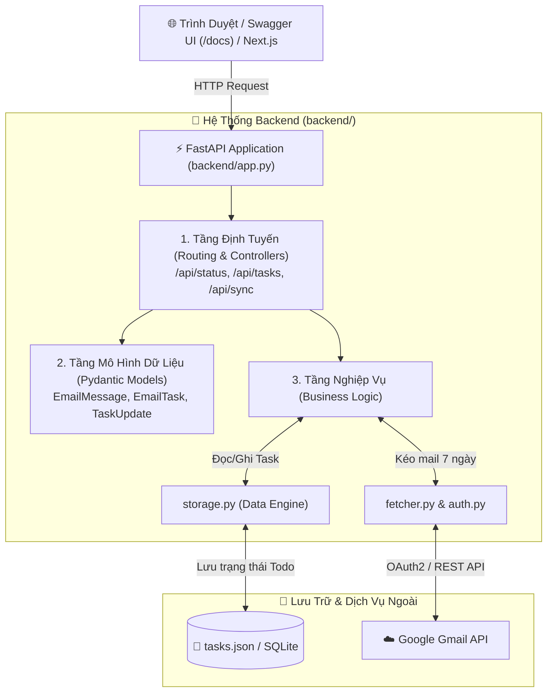
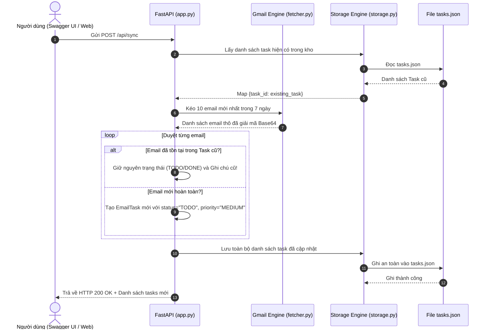
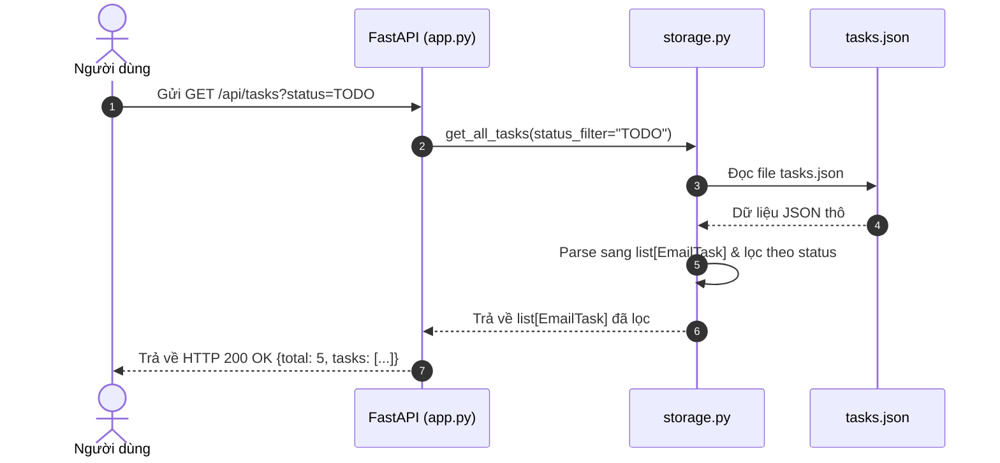
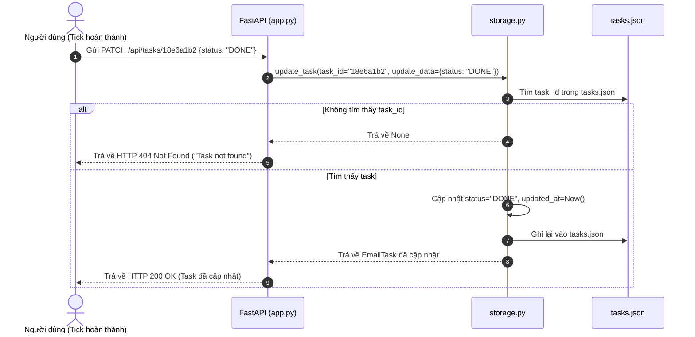

# 📌 ĐỀ BÀI DỰ ÁN - STAGE 2: XÂY DỰNG BACKEND FASTAPI, MÔ HÌNH HÓA TASK & RESTFUL API

---

## 🎯 1. Mục Đích Sau Khi Xong Stage 2 (Definition of Done)

Sau khi hoàn thành Stage 1 (kéo email dạng CLI), Stage 2 sẽ đưa bạn từ một lập trình viên viết script đơn giản lên tầm **kỹ sư Backend xây dựng Web API chuẩn mực**:

### 🏆 Sản phẩm thực tế bạn sở hữu:
1. **Một Web API Server hoàn chỉnh với FastAPI**: Chạy trên `http://localhost:8000`, có giao diện **Swagger UI** tương tác trực quan tại `/docs`.
2. **Cơ chế mô hình hóa dữ liệu (Pydantic Models)**: Biến các email thô thành đối tượng `EmailTask` có trạng thái rõ ràng (`TODO`, `IN_PROGRESS`, `DONE`, `ARCHIVED`), độ ưu tiên, ghi chú cá nhân và hạn chót.
3. **Động cơ lưu trữ cục bộ (Local Storage Engine)**: Tự động lưu trữ và đồng bộ dữ liệu vào `tasks.json` (hoặc SQLite), đảm bảo tắt server bật lại vẫn giữ nguyên mọi việc đã đánh dấu hoàn thành.
4. **Cơ chế Sync thông minh (Smart Merge)**: Kéo email mới từ Gmail về nhưng **không ghi đè** lên trạng thái hay ghi chú của những task bạn đã xử lý trước đó.
5. **Nền tảng sẵn sàng cho Next.js (Stage 3)**: Mọi endpoint đều thiết lập CORS và trả về định dạng JSON chuẩn RESTful, giúp giao diện Frontend gọi API mượt mà.

### 🧠 Năng lực lập trình tích lũy:
* Làm chủ framework **FastAPI** và máy chủ bất đồng bộ **Uvicorn (ASGI)**.
* Thành thạo **Pydantic v2**: Xác thực dữ liệu (Validation), tự động chuyển đổi kiểu (Serialization), tạo OpenAPI Schema.
* Tư duy thiết kế **Kiến trúc phần mềm phân tầng (Layered Architecture)**: Tách rời Controller (Endpoints), Service (Business Logic), và Repository/Storage (Data Access).
* Nắm vững các chuẩn thiết kế **RESTful API**: HTTP Methods (`GET`, `POST`, `PATCH`), Status Codes (`200 OK`, `404 Not Found`), Query Parameters và Request Body.

---

## 📊 2. Sơ Đồ Quy Trình & Kiến Trúc Hoạt Động (Flow Diagrams)

### 2.1. Sơ Đồ Tổng Quan: Kiến Trúc Phân Tầng Của Backend (Layered Architecture)



---

### 2.2. Sơ Đồ Luồng Xử Lý 3 Thao Tác Cốt Lõi (Core API Flows)

#### A. Luồng Kéo Email & Đồng Bộ Task (`POST /api/sync`)


#### B. Luồng Lấy Danh Sách Task (`GET /api/tasks?status=...`)


#### C. Luồng Cập Nhật Tiến Độ Task (`PATCH /api/tasks/{task_id}`)


---

## 📁 3. Trách Nhiệm Từng File Trong Thư Mục `backend/`

Dự án tuân thủ kiến trúc phân tách trách nhiệm (Separation of Concerns):

```text
backend/
├── app.py                      # [TẦNG GIAO TIẾP] Khởi tạo FastAPI app, cấu hình CORS, định nghĩa Endpoints
├── main.py                     # [CLI TEST RUNNER] Giữ lại từ Stage 1 để test nhanh trên terminal
├── credentials.json            # [BẢO MẬT] Thông tin ứng dụng Google Cloud
├── token.json                  # [BẢO MẬT] Token đăng nhập của tài khoản người dùng
├── tasks.json                  # [CƠ SỞ DỮ LIỆU] File JSON lưu trữ danh sách tasks (tự sinh)
└── src/focus_email/
    ├── __init__.py             # Export các class & hàm cốt lõi ra ngoài package
    ├── auth.py                 # [TẦNG BẢO MẬT] Xử lý xác thực OAuth2 & tự động làm mới token
    ├── fetcher.py              # [TẦNG DỮ LIỆU GMAIL] Kéo email, bóc tách cây MIME, giải mã Base64URL
    ├── models.py               # [TẦNG SCHEMA] Định nghĩa cấu trúc Pydantic Models & Enums
    └── storage.py              # [TẦNG LƯU TRỮ LOCAL] Đọc/ghi tasks.json, quản lý thêm/sửa/lọc task
```

| File | Trách nhiệm chính | Tại sao cần? |
| :--- | :--- | :--- |
| **`models.py`** | Định nghĩa `EmailMessage`, `EmailTask`, `TaskStatus`, `TaskPriority`, `TaskUpdate`. | Là "bản thiết kế chung" cho toàn bộ hệ thống; giúp IDE autocomplete chuẩn và FastAPI tự động sinh JSON Schema. |
| **`storage.py`** | Đọc/ghi an toàn vào `tasks.json`, thực hiện các hàm CRUD (`save_tasks`, `get_all_tasks`, `update_task`). | Tách biệt hoàn toàn việc lưu trữ file ra khỏi Web API; nếu sau này đổi sang SQLite hay PostgreSQL thì chỉ cần sửa file này mà không phải sửa `app.py`. |
| **`app.py`** | Nhận request từ trình duyệt, gọi `storage.py` và `fetcher.py` xử lý, trả về response JSON. | Đóng vai trò "nhạc trưởng", kết nối các module với giao thức HTTP của trình duyệt. |

---

## 🌐 4. Thiết Kế Chuẩn RESTful API

Hệ thống cung cấp 5 REST Endpoints chuẩn mực:

### 1. `GET /`
* **Mục đích**: Health check kiểm tra server có đang sống không.
* **HTTP Status**: `200 OK`
* **Response**:
  ```json
  {
    "status": "online",
    "service": "FocusEmail Backend",
    "docs_url": "/docs"
  }
  ```

### 2. `GET /api/status`
* **Mục đích**: Kiểm tra ứng dụng đã đăng nhập tài khoản Gmail chưa.
* **HTTP Status**: `200 OK`
* **Response**:
  ```json
  {
    "authenticated": true,
    "user_email": "t20067771@gmail.com"
  }
  ```

### 3. `GET /api/tasks`
* **Mục đích**: Lấy danh sách các task để hiển thị lên giao diện Focus Checklist hoặc Kanban.
* **Query Parameters**:
  * `status` *(tùy chọn)*: Lọc theo `"TODO"`, `"IN_PROGRESS"`, `"DONE"`, `"ARCHIVED"`. Nếu không truyền thì lấy tất cả.
* **HTTP Status**: `200 OK`
* **Response**:
  ```json
  {
    "total": 2,
    "tasks": [
      {
        "task_id": "18e6a1b2c3d4e5f6",
        "status": "TODO",
        "priority": "HIGH",
        "notes": "Cần phản hồi trước 5h chiều",
        "due_date": "2026-09-30",
        "created_at": "2026-09-27T14:00:00Z",
        "updated_at": "2026-09-27T14:00:00Z",
        "email": {
          "id": "18e6a1b2c3d4e5f6",
          "thread_id": "18e6a1b2c3d4e5f6",
          "sender_name": "Google Security",
          "sender_email": "no-reply@accounts.google.com",
          "recipient": "t20067771@gmail.com",
          "subject": "Cảnh báo bảo mật mới",
          "date": "Sun, 27 Sep 2026 12:00:00 +0000",
          "snippet": "Một thiết bị lạ vừa đăng nhập...",
          "body_text": "Chi tiết cảnh báo đăng nhập...",
          "body_html": "<p>Chi tiết...</p>",
          "is_unread": true,
          "labels": ["INBOX", "UNREAD"]
        }
      }
    ]
  }
  ```

### 4. `PATCH /api/tasks/{task_id}`
* **Mục đích**: Cập nhật trạng thái (tick hoàn thành), đổi độ ưu tiên hoặc thêm ghi chú cho 1 task cụ thể.
* **Path Parameter**: `task_id` (chuỗi ID của task).
* **Request Body** (`TaskUpdate`):
  ```json
  {
    "status": "DONE",
    "notes": "Đã gửi phản hồi xong"
  }
  ```
* **HTTP Status**:
  * `200 OK`: Cập nhật thành công, trả về toàn bộ thông tin `EmailTask` mới nhất.
  * `404 Not Found`: Không tìm thấy task có ID tương ứng.

### 5. `POST /api/sync`
* **Mục đích**: Bấm nút "Làm mới / Đồng bộ" trên giao diện để kết nối Gmail API, kéo email 7 ngày gần nhất về và merge vào danh sách task.
* **HTTP Status**: `200 OK`
* **Response**:
  ```json
  {
    "message": "Đồng bộ thành công!",
    "total_synced": 5,
    "new_tasks_added": 2
  }
  ```

---

## 🧩 5. Chi Tiết Các Thử Thách Cần Thực Hiện (Step-by-Step)

Bạn sẽ lần lượt hoàn thiện 3 bước lớn:

---

### 🟢 THỬ THÁCH 2.1: Hoàn Thiện Pydantic Models (`models.py`)
* **File mục tiêu**: [`backend/src/focus_email/models.py`](file:///home/billtran/Desktop/EmailTool/backend/src/focus_email/models.py) *(Đã có bản mẫu chuẩn)*.
* **Nhiệm vụ**:
  1. Hiểu bản chất các Enum: `TaskStatus` (`TODO`, `IN_PROGRESS`, `DONE`, `ARCHIVED`) và `TaskPriority` (`LOW`, `MEDIUM`, `HIGH`).
  2. Nắm rõ cách lồng ghép Model: Model `EmailTask` chứa bên trong một đối tượng `EmailMessage`.
  3. Sử dụng `Field(default=..., description=...)` để tài liệu Swagger UI tự động hiển thị mô tả tiếng Việt dễ hiểu.

---

### 🟢 THỬ THÁCH 2.2: Xây Dựng Engine Lưu Trữ Cục Bộ (`storage.py`)
* **File mục tiêu**: [`backend/src/focus_email/storage.py`](file:///home/billtran/Desktop/EmailTool/backend/src/focus_email/)
* **Nhiệm vụ**: Viết class `TaskStorage` quản lý việc lưu trữ vào file [`backend/tasks.json`](file:///home/billtran/Desktop/EmailTool/backend/):
  1. **Hàm `load_all() -> list[EmailTask]`**:
     * Đọc file `tasks.json`. Nếu file chưa tồn tại thì trả về danh sách rỗng `[]`.
     * Chuyển đổi từng phần tử JSON dạng dict thành đối tượng `EmailTask.model_validate(item)`.
  2. **Hàm `save_all(tasks: list[EmailTask])`**:
     * Chuyển danh sách `EmailTask` thành JSON (`[t.model_dump() for t in tasks]`).
     * Ghi đè vào file `tasks.json` với `indent=2` và `ensure_ascii=False` để hỗ trợ tiếng Việt có dấu.
  3. **Hàm `get_tasks(status: Optional[TaskStatus] = None) -> list[EmailTask]`**:
     * Lấy toàn bộ danh sách task, nếu có truyền `status` thì lọc theo `status`.
  4. **Hàm `get_task_by_id(task_id: str) -> Optional[EmailTask]`**:
     * Tìm kiếm và trả về task có `task_id` tương ứng.
  5. **Hàm `update_task(task_id: str, update_data: TaskUpdate) -> Optional[EmailTask]`**:
     * Tìm task trong danh sách. Nếu thấy, chỉ cập nhật các trường có giá trị khác `None`.
     * Tự động cập nhật `updated_at = datetime.now(timezone.utc).isoformat()`.
     * Gọi `save_all()` để lưu lại.
  6. **Hàm `merge_emails(emails: list[dict]) -> tuple[int, int]`**:
     * Nhận danh sách email thô từ Gmail API.
     * Kiểm tra từng email: nếu đã có trong `tasks.json` thì giữ nguyên trạng thái cũ; nếu chưa có thì tạo mới `EmailTask` với `status="TODO"`.
     * Lưu lại toàn bộ và trả về `(tổng_số_email, số_task_mới_được_thêm)`.

---

### 🟢 THỬ THÁCH 2.3: Xây Dựng & Đăng Ký Router Trong `app.py`
* **File mục tiêu**: [`backend/app.py`](file:///home/billtran/Desktop/EmailTool/backend/app.py)
* **Nhiệm vụ**:
  1. Khởi tạo đối tượng `storage = TaskStorage()`.
  2. Viết route `GET /api/tasks`: Lấy danh sách task từ storage, hỗ trợ query parameter `status`.
  3. Viết route `GET /api/tasks/{task_id}`: Lấy chi tiết 1 task, trả về HTTP 404 nếu không tìm thấy.
  4. Viết route `PATCH /api/tasks/{task_id}`: Cập nhật trạng thái task, trả về HTTP 404 nếu sai ID.
  5. Viết route `POST /api/sync`: Kéo Gmail API bằng `fetch_recent_emails()`, đưa vào `storage.merge_emails()` để lưu trữ.

---

### 🧪 6. Test Gate (Tiêu Chuẩn Nghiệm Thu Stage 2)

Bạn đạt chuẩn hoàn thành Stage 2 khi thực hiện đầy đủ kịch bản kiểm thử sau trên **Swagger UI** (`http://localhost:8000/docs`):

1. **Test 1 - Kiểm tra trạng thái**:
   * Bấm vào `GET /api/status` ➔ Bấm **Try it out** ➔ **Execute**.
   * Kết quả: Trả về HTTP 200 với `authenticated: true`.
2. **Test 2 - Đồng bộ email thành Task**:
   * Bấm vào `POST /api/sync` ➔ Bấm **Execute**.
   * Kết quả: Hệ thống báo đồng bộ thành công ít nhất 1-5 email và file [`backend/tasks.json`](file:///home/billtran/Desktop/EmailTool/backend/) xuất hiện trên đĩa.
3. **Test 3 - Lấy danh sách Task**:
   * Bấm vào `GET /api/tasks` ➔ Bấm **Execute**.
   * Kết quả: Trả về danh sách JSON chứa các task với đầy đủ trường dữ liệu.
4. **Test 4 - Tick hoàn thành 1 Task**:
   * Lấy `task_id` của 1 task từ Test 3.
   * Bấm vào `PATCH /api/tasks/{task_id}` ➔ Nhập body: `{"status": "DONE", "notes": "Đã xử lý xong"}` ➔ **Execute**.
   * Kết quả: Task đó chuyển thành `"status": "DONE"`.
5. **Test 5 - Kiểm tra tính bền vững (Persistence Test)**:
   * Tắt server (`Ctrl + C`) trong terminal ➔ Chạy lại `uvicorn app:app --reload`.
   * Gọi lại `GET /api/tasks`: Task vừa đánh dấu `DONE` vẫn giữ nguyên trạng thái `DONE`, không bị mất!

---

## 📝 7. Báo Cáo Đúc Kết Kiến Thức Sau Stage 2
```markdown
# 📝 BÁO CÁO ĐÚC KẾT KIẾN THỨC - STAGE 2: BACKEND FASTAPI & RESTFUL API

### 1. 🎯 Mục tiêu đã đạt được:
- [x] Đã hiểu cách thức hoạt động của FastAPI và Swagger UI (/docs).
- [x] Đã làm chủ Pydantic Model để xác thực và serialize dữ liệu.
- [x] Đã xây dựng cơ chế lưu trữ cục bộ độc lập với Database phức tạp.
- [x] Đã hiểu tư duy Smart Merge để không bị ghi đè dữ liệu khi kéo email mới.

### 2. 🧠 Những khái niệm / kỹ thuật mới học được:
- FastAPI Dependency & Router: ...
- Pydantic BaseModel vs Python Dataclass: ...
- HTTP Methods (GET, POST, PATCH) & RESTful Best Practices: ...
- Safe File Writing trong Python: ...

### 3. ⭐ Điểm tự đánh giá mức độ tự tin (1 - 10): .../10
```
